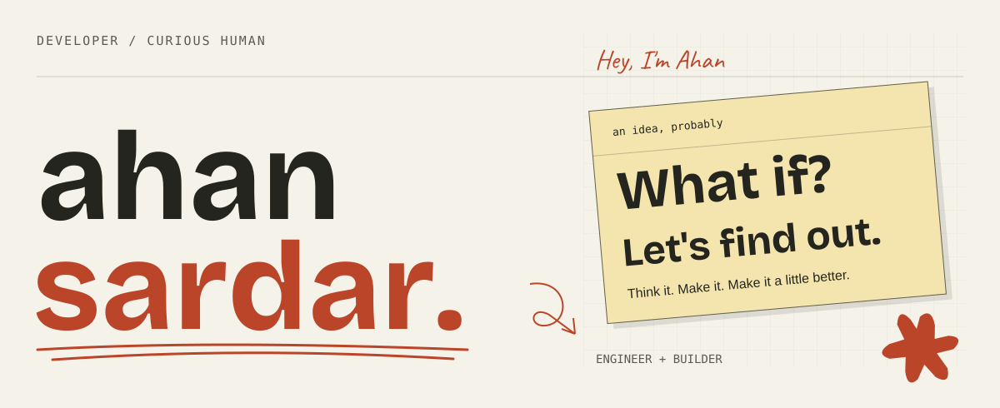
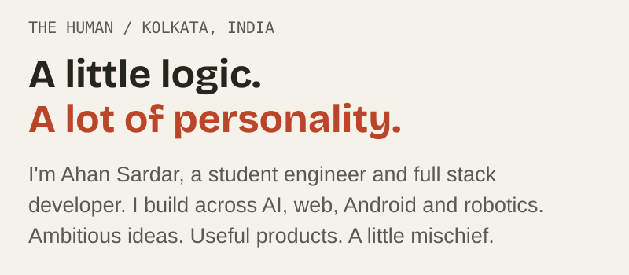
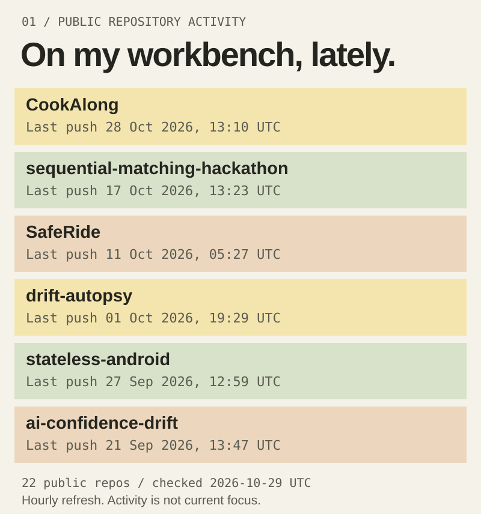
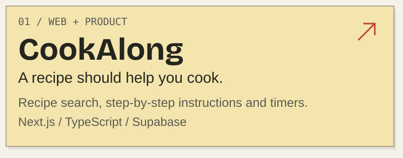
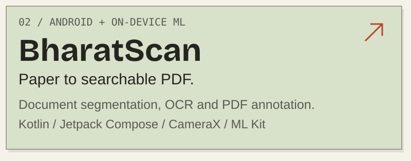
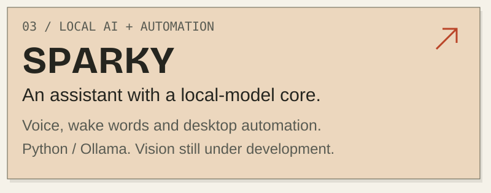
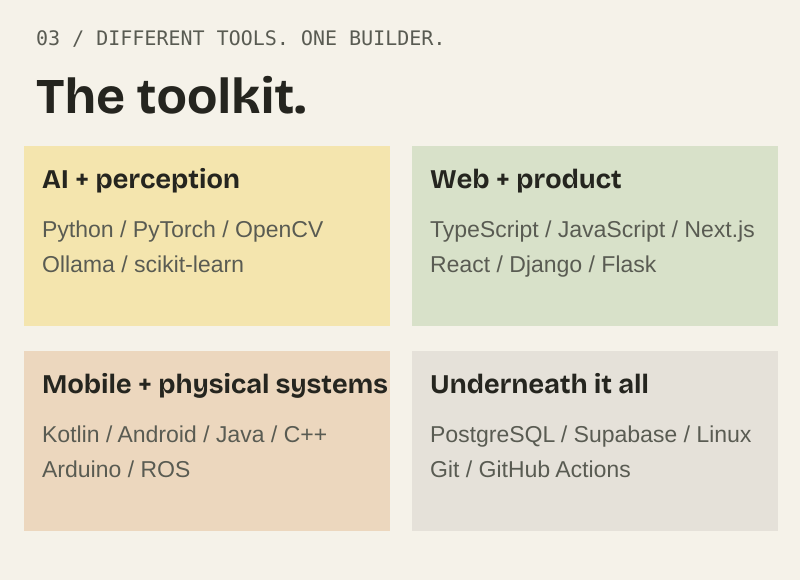
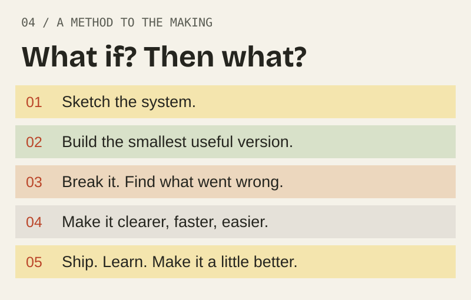
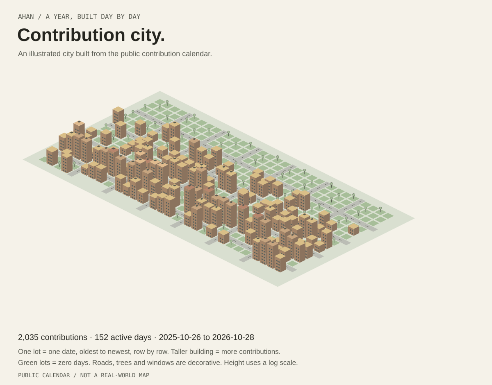

<picture><source media="(prefers-color-scheme: dark)" srcset="./assets/profile-header-dark.svg" /></picture>

<a href="https://ahansardar.vercel.app"><b>Portfolio ↗</b></a> &nbsp; / &nbsp; <a href="https://www.linkedin.com/in/ahansardar"><b>LinkedIn ↗</b></a> &nbsp; / &nbsp; <a href="mailto:ahansardarvis@gmail.com"><b>Say hello ↗</b></a>

<picture><source media="(prefers-color-scheme: dark)" srcset="./assets/about-mobile-dark.svg" /><source media="(max-width: 600px)" srcset="./assets/about-mobile.svg" /></picture>

<!-- PUBLIC_ACTIVITY:START -->
<picture><source media="(prefers-color-scheme: dark)" srcset="./assets/public-activity-mobile-dark.svg" /><source media="(max-width: 600px)" srcset="./assets/public-activity-mobile.svg" /></picture>

<b>Activity links, dates and all public repositories</b>

Recent pushes across my public repositories. This is activity, not a claim that every project is my current focus.

<ul>
<li><a href="https://github.com/ahansardar/CookAlong">CookAlong</a> - last push 28 Oct 2026, 13:10 UTC</li>
<li><a href="https://github.com/ahansardar/sequential-matching-hackathon">sequential-matching-hackathon</a> - last push 17 Oct 2026, 13:23 UTC</li>
<li><a href="https://github.com/ahansardar/SafeRide">SafeRide</a> - last push 11 Oct 2026, 05:27 UTC</li>
<li><a href="https://github.com/ahansardar/drift-autopsy">drift-autopsy</a> - last push 01 Oct 2026, 19:29 UTC</li>
<li><a href="https://github.com/ahansardar/stateless-android">stateless-android</a> - last push 27 Sep 2026, 12:59 UTC</li>
<li><a href="https://github.com/ahansardar/ai-confidence-drift">ai-confidence-drift</a> - last push 21 Sep 2026, 13:47 UTC</li>
</ul>

Public repository data last checked: 2026-10-29 (UTC). Refreshes about hourly; GitHub can delay scheduled runs.

All public repositories (22)

<ul>
<li><a href="https://github.com/ahansardar/ahansardar">ahansardar</a></li>
<li><a href="https://github.com/ahansardar/ai-confidence-drift">ai-confidence-drift</a></li>
<li><a href="https://github.com/ahansardar/Auto-Document-Generator">Auto-Document-Generator</a></li>
<li><a href="https://github.com/ahansardar/BharatScan">BharatScan</a></li>
<li><a href="https://github.com/ahansardar/CookAlong">CookAlong</a></li>
<li><a href="https://github.com/ahansardar/database">database</a></li>
<li><a href="https://github.com/ahansardar/drift-autopsy">drift-autopsy</a></li>
<li><a href="https://github.com/ahansardar/DroidBridge">DroidBridge</a></li>
<li><a href="https://github.com/ahansardar/GeoAtlas">GeoAtlas</a></li>
<li><a href="https://github.com/ahansardar/localwatch-server">localwatch-server</a></li>
<li><a href="https://github.com/ahansardar/QR-File-Sharing">QR-File-Sharing</a></li>
<li><a href="https://github.com/ahansardar/resume-maker">resume-maker</a></li>
<li><a href="https://github.com/ahansardar/SafeRide">SafeRide</a></li>
<li><a href="https://github.com/ahansardar/sequential-matching-hackathon">sequential-matching-hackathon</a></li>
<li><a href="https://github.com/ahansardar/SPARKY">SPARKY</a></li>
<li><a href="https://github.com/ahansardar/SpeedSync">SpeedSync</a></li>
<li><a href="https://github.com/ahansardar/stateless-android">stateless-android</a></li>
<li><a href="https://github.com/ahansardar/StreamLink">StreamLink</a></li>
<li><a href="https://github.com/ahansardar/Veda">Veda</a></li>
<li><a href="https://github.com/ahansardar/veyra">veyra</a></li>
<li><a href="https://github.com/ahansardar/webiner-ties">webiner-ties</a></li>
<li><a href="https://github.com/ahansardar/x-scraper">x-scraper</a></li>
</ul>

Private repositories are excluded. Forks and archived repositories are labelled. The profile repository appears in the directory but not in recent pushes, so its automatic updates do not drown out project activity.

<!-- PUBLIC_ACTIVITY:END -->

<a href="https://github.com/ahansardar/CookAlong"><picture><source media="(prefers-color-scheme: dark)" srcset="./assets/cookalong-mobile-dark.svg" /><source media="(max-width: 600px)" srcset="./assets/cookalong-mobile.svg" /></picture></a>

[Try CookAlong live ↗](https://cookalong.vercel.app/) · [Source ↗](https://github.com/ahansardar/CookAlong)

<a href="https://github.com/ahansardar/BharatScan"><picture><source media="(prefers-color-scheme: dark)" srcset="./assets/bharatscan-mobile-dark.svg" /><source media="(max-width: 600px)" srcset="./assets/bharatscan-mobile.svg" /></picture></a>

[BharatScan source ↗](https://github.com/ahansardar/BharatScan)

<a href="https://github.com/ahansardar/SPARKY"><picture><source media="(prefers-color-scheme: dark)" srcset="./assets/sparky-mobile-dark.svg" /><source media="(max-width: 600px)" srcset="./assets/sparky-mobile.svg" /></picture></a>

[SPARKY source ↗](https://github.com/ahansardar/SPARKY) · [All projects ↗](https://github.com/ahansardar?tab=repositories)

<picture><source media="(prefers-color-scheme: dark)" srcset="./assets/toolkit-mobile-dark.svg" /><source media="(max-width: 600px)" srcset="./assets/toolkit-mobile.svg" /></picture>

<picture><source media="(prefers-color-scheme: dark)" srcset="./assets/process-mobile-dark.svg" /><source media="(max-width: 600px)" srcset="./assets/process-mobile.svg" /></picture>

<b>Read the profile as text</b>

I'm Ahan Sardar, a student engineer and full stack developer in Kolkata. I build across AI, web, Android and robotics.

- **CookAlong:** recipe search, step-by-step instructions and timers. Next.js, TypeScript and Supabase.
- **BharatScan:** on-device document segmentation, OCR and PDF annotation. Kotlin, Jetpack Compose, CameraX and ML Kit.
- **SPARKY:** voice, wake words and desktop automation. Python and Ollama. Vision is still under development.

**Toolkit:** Python, PyTorch, OpenCV, Ollama, scikit-learn; TypeScript, JavaScript, Next.js, React, Django, Flask; Kotlin, Android, Java, C++, Arduino, ROS; PostgreSQL, Supabase, Linux, Git, GitHub Actions.

**Process:** sketch the system; build the smallest useful version; break it and find what went wrong; make it clearer, faster and easier; ship, learn and make it a little better.

I'm interested in practical AI, thoughtful interfaces and systems that hold up beyond the demo.

<!-- CONTRIBUTION_CITY:START -->
<picture><source media="(prefers-color-scheme: dark)" srcset="./profile-city/city-dark.svg" /></picture>

**2,037 contributions across 152 active dates** · 2025-10-26 to 2026-10-29.

Each plot is one date, oldest to newest, row by row. Taller buildings mean more contributions, using a logarithmic scale. Green plots are zero days. Roads, trees, windows and roof details are decoration, not extra activity.

[Open dark city full-size](./profile-city/city-dark.svg) · [Open light city full-size](./profile-city/city-light.svg) · [Daily contribution data](./profile-city/contribution-days.json)

Built daily from the publicly visible GitHub contribution calendar. This can include anonymous private-contribution counts if enabled on my profile. No private repository details are read. GitHub activity is not a measure of skill.

[Original contribution city](./profile-3d-contrib/profile-season-animate.svg) · [Achievements tracker](./ACHIEVEMENTS_TRACKER.md)
<!-- CONTRIBUTION_CITY:END -->

<a href="mailto:ahansardarvis@gmail.com"><picture><source media="(prefers-color-scheme: dark)" srcset="./assets/contact-mobile-dark.svg" /><source media="(max-width: 600px)" srcset="./assets/contact-mobile.svg" /></picture></a>

[Let's talk ↗](mailto:ahansardarvis@gmail.com) · [Portfolio ↗](https://ahansardar.vercel.app/) · [LinkedIn ↗](https://www.linkedin.com/in/ahansardar)
